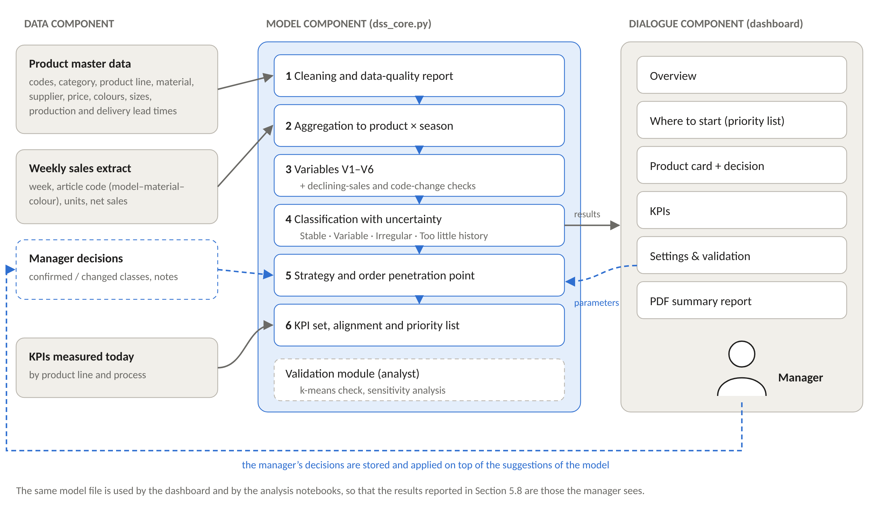
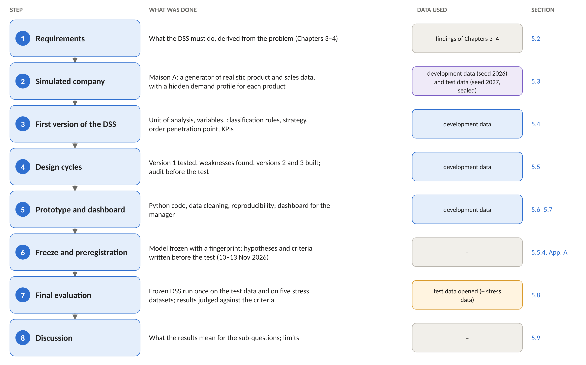
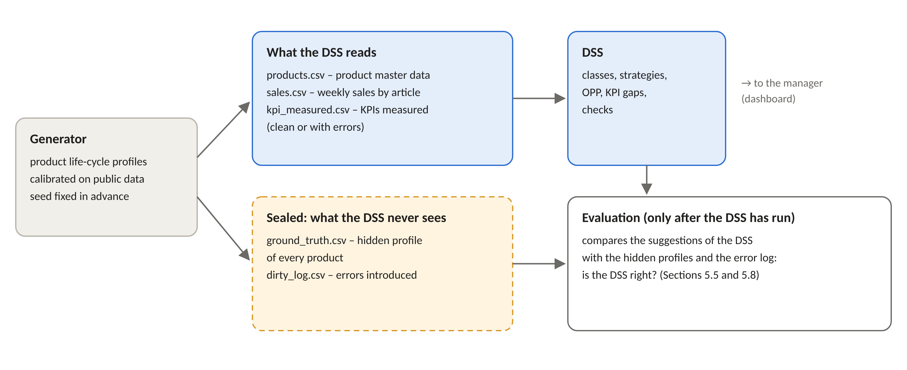
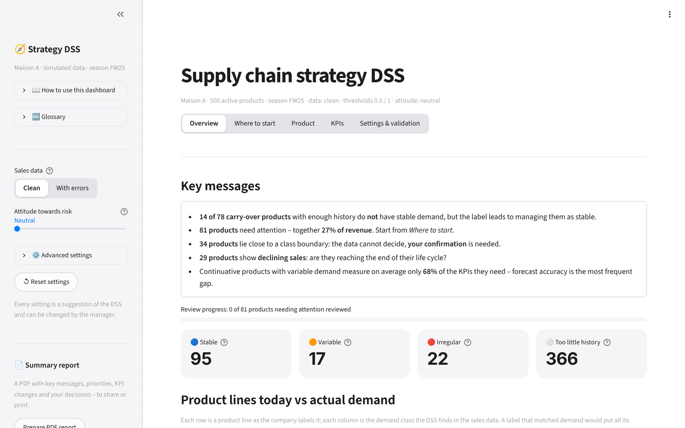

# Design of a Data-Driven Decision Support System for Supply Chain Strategy Selection and Performance Measurement in Luxury Fashion

Replication package of the master's thesis of **Chiara Tagiullo** – MSc in Management Engineering (Business Intelligence and Analytics), Sapienza University of Rome, 2026.

**Live dashboard:** https://maison-a-dss.streamlit.app/ (development data of the simulated company Maison A; decisions saved online are kept only while the app is running).

This repository contains everything needed to reproduce Chapter 5 of the thesis: the decision support system (DSS), its dashboard, the generator of the simulated company *Maison A*, the datasets, the evaluation notebook, the preregistration of the final evaluation and its results.

> **Note on the data.** All data in this repository are simulated. No real company data were used. The generator is calibrated on published figures (Bindi et al., 2023) and on the public online catalogues of five luxury maisons; its parameters and sources are listed in `maison_a/parameters_sources.csv` and in Appendix B of the thesis.

---

## What the DSS does

Luxury fashion companies choose the supply chain strategy of a product, and the KPIs with which they monitor it, according to its **product line label** (permanent, carry-over, seasonal, capsule). The DSS proposes instead to look at how the demand of each product actually behaves. From the product master data and the weekly sales extract, for every product (model + material) it:

1. measures how its seasonal sales vary (coefficient of variation, CV) and on how many seasons;
2. classifies its demand as **Stable**, **Variable**, **Irregular** or **Too little history**, flagging the classes that the data cannot settle (*class to confirm*), declining products and possible code changes;
3. suggests a **supply chain strategy** (lean, hybrid, agile) and a position of the **order penetration point** (MTS, ATO, MTO);
4. derives the **KPIs** the product needs and compares them with those the company measures today.

The manager explores the results in a Streamlit dashboard, can change every parameter and confirms or changes each suggestion.



## How the work was done



The DSS was evaluated as a **blind test** on the simulated company Maison A: each product is generated from a hidden demand profile (e.g. stable or oscillating) that the DSS never sees and that is opened only to check its suggestions. The DSS was built and improved on a **development** dataset (seed 2026); its final version (3.2) was then **frozen** with a SHA-256 fingerprint, the hypotheses were **preregistered** (`PREREGISTRATION.md`), and only then was it run once on a sealed **test** dataset (seed 2027) and on five stress datasets.



## Repository structure

| Path | Content |
|---|---|
| `dss_core.py` | Model of the DSS, version 3.2 (frozen): cleaning, aggregation, variables, classification, strategy and OPP, KPI alignment, checks, priority list, clustering check |
| `VERSION.json` | Version, date of freezing, SHA-256 fingerprints of the model and of its parameters, version history |
| `app.py`, `report_pdf.py`, `.streamlit/` | Dashboard (Streamlit) and PDF summary report |
| `maison_a_generator.py` | Generator of the simulated company Maison A |
| `dss_evaluation.py`, `stress_scenarios.json` | Evaluation notebook (modes `dev` and `test`) and stress scenarios |
| `PREREGISTRATION.md` | Preregistration of the final evaluation, with Addendum 1 (Appendix A of the thesis) |
| `maison_a/` | Development dataset (seed 2026): clean and dirty data, hidden profiles, error log, parameters and sources |
| `maison_a_test/` | Test dataset (seed 2027), same structure |
| `results_dev/`, `results_test/` | Tables, figures and summary of the dry run and of the final evaluation |
| `versions/` | Earlier frozen versions 3.0 and 3.1 of the model |
| `docs/` | Images used in this README |

Files read by the DSS: `products.csv`, `sales.csv`, `kpi_measured.csv` (or their `_dirty` versions). Files used **only** by the evaluation: `ground_truth.csv` (hidden profiles) and `dirty_log.csv` (errors introduced).

## Quick start

Requires Python 3.10 or later.

```bash
pip install -r requirements.txt

# Open the dashboard locally (development data of Maison A)
# or use the online version: https://maison-a-dss.streamlit.app/
streamlit run app.py
```



## Reproducing the results of Chapter 5

```bash
# 1. Regenerate the datasets (identical to those in the repository)
MAISON_SEED=2026 python maison_a_generator.py     # -> maison_a/
MAISON_SEED=2027 python maison_a_generator.py     # -> maison_a_test/

# 2. Run the evaluation (the stress datasets are generated automatically)
EVAL_MODE=dev  python dss_evaluation.py            # dry run        -> results_dev/
EVAL_MODE=test python dss_evaluation.py            # final evaluation -> results_test/
```

In test mode the notebook checks the fingerprint of `dss_core.py` and of its parameters against `VERSION.json` and stops if they differ. On Windows (PowerShell) set the variables with `$env:MAISON_SEED=2026` and `$env:EVAL_MODE="test"` before the command.

| Version | Fingerprint of `dss_core.py` (SHA-256) |
|---|---|
| 3.2 (evaluated) | `9ffb6c9a96172eab1c65a697d111613f9e214af395cb100a6c62e2efb0c54d06` |

## Results of the preregistered hypotheses (test data)

| # | Criterion | Dry run (development) | Test | Met |
|---|---|---|---|---|
| H1 | non-stable products flagged ≥ 50% (labels: 0%) | 71% | **54%** | yes |
| H2a | stable products flagged ≤ 20% | 12% | **4%** | yes |
| H2b | stable products classified Variable/Irregular ≤ 5% | 0% | **0%** | yes |
| H3 | forecast error of missed < flagged products | 28% vs 51% | **24% vs 46%** | yes |
| H4 | same class with clean and dirty data ≥ 95% | 99.6% | **100%** | yes |
| H5 | KPI alignment: Variable < Stable | 76% vs 100% | **71% vs 100%** | yes |

The full results, including the less favourable ones and what each check does not show, are discussed in Section 5.8 of the thesis and in `results_test/summary.md`.

## Main reference

Bindi, B., Bandinelli, R., Fani, V., & Pero, M. E. P. (2023). Supply chain strategy in the luxury fashion industry: Impacts on performance indicators. *International Journal of Productivity and Performance Management*, 72(5), 1338–1366. https://doi.org/10.1108/IJPPM-02-2021-0079
